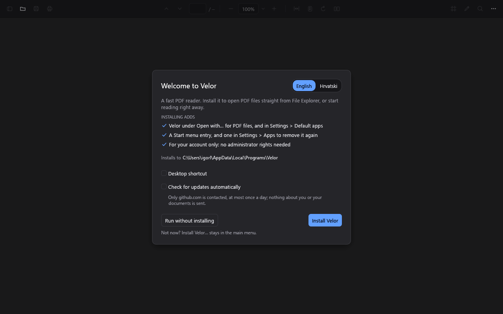
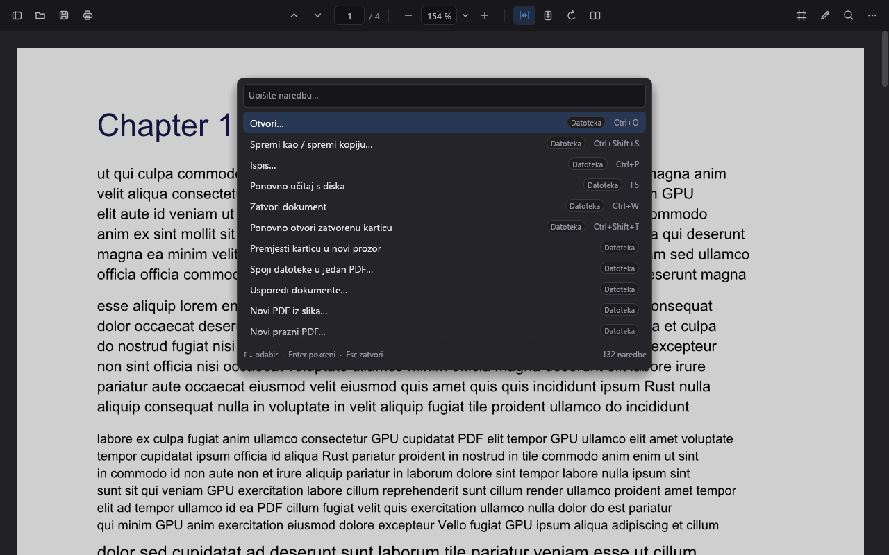

  

<h1 align="center">Velor</h1>

  <strong>Fast, native GPU-accelerated PDF reader, editor, signing &amp; prepress suite for Windows.</strong> 
  Single 34 MB executable · 100% offline · Zero subscriptions · English &amp; Hrvatski

  <a href="https://velor.voidown.com">
    <strong>🌐 Website &amp; Benchmarks (velor.voidown.com)</strong>
  </a>
  &nbsp;·&nbsp;
  <a href="https://github.com/Igor9232/Velor/releases/download/v0.2.2/Velor-0.2.2-x64.exe">
    <strong>⬇ Download Velor 0.2.2 for Windows (x64)</strong>
  </a>
  &nbsp;·&nbsp;
  <a href="https://github.com/Igor9232/Velor/releases/latest">All releases &amp; SHA-256</a>

---

### Why Velor?

- **GPU-first rendering (DirectX 12 &amp; Vulkan)** — 100% pure Rust (`hayro` + `Vello` compute shaders on `wgpu`). Smooth 60–240 Hz scrolling and zooming even on multi-hundred-megabyte CMYK print banners and 180k-vector sheets.
- **Built-in installer &amp; Windows integration** — open `Velor-0.2.2-x64.exe`, pick **English** or **Hrvatski**, and install per-user without administrator rights, or run portable right away.
- **Full PDF toolkit** — direct text/image editing, 25+ annotation tools, interactive forms (FDF/XFDF/CSV/flatten), page organizer (merge, split, crop, resize, watermarks, Bates, bookmarks), PDF/A-2b/3b, optimization, and export to DOCX, Markdown, HTML, CSV, SVG, PNG, JPEG, and TIFF.
- **Security &amp; digital signatures** — permanent redaction, hidden-data sanitization, AES-256 protection, and PAdES digital signing &amp; verification (Windows certificate store / smart cards / PFX, RFC 3161 timestamps, OCSP/CRL, EU trusted lists).
- **Prepress &amp; print production** — CMYK + spot separation preview, overprint &amp; ICC soft-proofing, TAC inspection, calibrated `/VP` measurements, preflight &amp; fixups, plus vector &amp; raster printing.
- **OCR, document comparison &amp; Command Palette (`Ctrl+K`)** — offline Windows OCR into searchable PDFs, word-level &amp; visual diff between PDFs, Reflow reading mode, and instant keyboard search across all commands.
- **Privacy by architecture** — HTTP clients (`reqwest`, `hyper`, `ureq`) are banned from the PDF reader at compile time (`cargo-deny`). Optional signed 1-click updates verify every release with ECDSA P-256 + SHA-256.

---

  

  

---

### System requirements

- **Windows 10 / 11** (64-bit, x86-64 CPU with SSE4.2)
- **GPU with DirectX 12 or Vulkan** (no external runtime or VC++ Redistributable required)

### Installation note (Windows SmartScreen)

Public Beta releases (`0.2.x`) are not yet signed with a commercial Authenticode certificate, so Windows SmartScreen may show *"Windows protected your PC"* on first launch. Click **More info → Run anyway** to start Velor, and verify the SHA-256 hash against [`SHA256SUMS.txt`](https://github.com/Igor9232/Velor/releases/latest/download/SHA256SUMS.txt).

---

*Copyright © Velor · [velor.voidown.com](https://velor.voidown.com)*